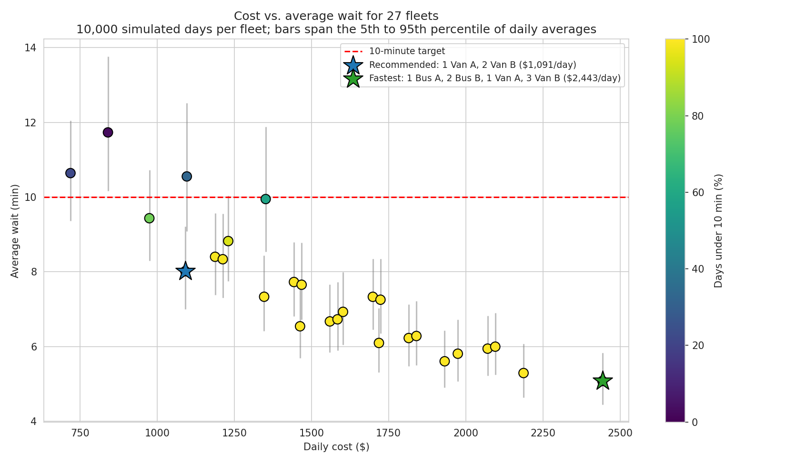
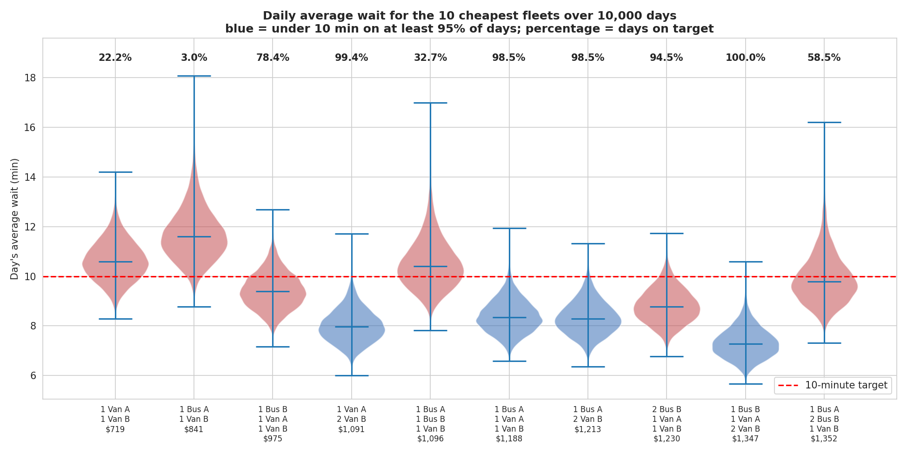
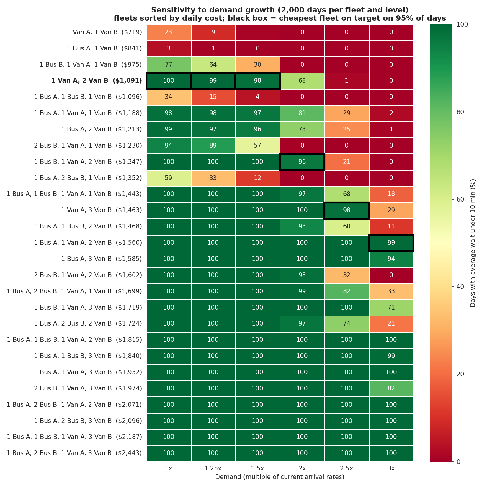

# Fleet Sizing with Monte Carlo Simulation

Which mix of buses and vans should run a corporate passenger shuttle from 6:00 to 22:00 so that passengers wait under 10 minutes, at the lowest daily cost? This project answers that with a discrete-event Monte Carlo simulation built on the service's real trip data: 27 feasible fleets, each simulated over the same 10,000 days (270,000 simulated days in total).

**Result:** the recommended fleet, 1 Van A + 2 Van B, costs **$1,091.20 a day** and keeps the day's average wait under 10 minutes on **99.4% of days** (mean 8.02 min). The cheapest fleet that meets the target only on average ($974.80) misses it on 22% of days, and the fastest fleet costs $493,000 more a year for 2.9 fewer minutes of waiting.



## The problem

| Vehicle | Seats | Hours | Cost per hour | Available |
|---|---|---|---|---|
| Bus A | 37 | 6:00 to 17:00 | $42.60 | 1 |
| Bus B | 31 | 8:00 to 14:00 | $42.60 | 2 |
| Van A | 19 | 6:00 to 20:00 | $24.80 | 1 |
| Van B | 13 | 7:00 to 22:00 | $24.80 | 3 |

Constraints: continuous service from 6:00 to 22:00 and no more vehicles than are available. 27 of the 47 possible combinations cover the whole day.

**Service target:** a fleet qualifies if the day's average wait is under 10 minutes on at least 95% of simulated days. A fleet whose long-run mean sits just under 10 minutes still fails the target on many individual days, so the mean alone is not enough.

## Method

- **Passenger arrivals** follow a non-homogeneous Poisson process with a rate that changes through the day: one passenger every 3.0 min (6 to 8), 2.0 min (8 to 10), 3.0 min (10 to 13), 1.6 min at the afternoon peak (13 to 17) and 2.6 min (17 to 22), about 425 passengers a day. Within each window the arrival count is Poisson and the times are uniform, which samples the process exactly.
- **Vehicle trips** start at the beginning of each shift; the time to each next departure is resampled from real gaps between departures recorded in four time windows (6 to 9, 9 to 14, 14 to 18 and 18 to 22).
- **Queueing:** all trips are merged in time order, passengers queue first come, first served, and each departing vehicle boards up to its capacity. Passengers still waiting at 22:00 are counted as unserved. The time-average queue comes from Little's law (total minutes waited divided by the length of the day).
- **Monte Carlo with common random numbers:** every fleet is simulated on the same 10,000 days. Day *k* has the same passenger arrivals in every fleet, and each individual vehicle has its own random stream, so a given van drives the same schedule on day *k* in every fleet that includes it. This cuts the variance of fleet-to-fleet differences by a median of 2.0x (up to 9.6x), measured against 2,000 days of independent sampling.
- **Precision:** the 95% confidence interval on every fleet's mean wait is within ±0.02 minutes. A full run takes about 30 seconds (100 microseconds per simulated day).
- **Metrics:** mean wait with confidence interval, distribution of the day's average wait (5th and 95th percentiles, share of days on target), 95th percentile and maximum wait per passenger, time-average and maximum queue, trips per day, vehicle occupancy and daily cost.

## Results

| Option | Fleet | Daily cost | Average wait | Days under 10 min | 95th pct. wait | Average queue |
|---|---|---|---|---|---|---|
| Cheapest on average | 1 Bus B, 1 Van A, 1 Van B | $974.80 | 9.43 min | 78.4% | 23.0 min | 4.2 |
| **Recommended** | **1 Van A, 2 Van B** | **$1,091.20** | **8.02 min** | **99.4%** | **20.9 min** | **3.5** |
| Fastest | 1 Bus A, 2 Bus B, 1 Van A, 3 Van B | $2,443.00 | 5.08 min | 100% | 14.4 min | 2.2 |

- 24 of 27 fleets have a mean wait under 10 minutes, but only 21 meet it on 95% of days.
- The recommended fleet costs $42,500 a year more than the cheapest-on-average fleet and raises the share of days on target from 78% to 99%. It costs $493,000 a year less than the fastest fleet.
- **Frequency, not capacity, drives the wait.** The recommended fleet fills about 29% of its seats per trip, so the wait depends on how often a vehicle arrives rather than on how many seats it has. That is why three vans beat fleets with buses at the same price.
- The afternoon peak (13:00 to 17:00) has the longest queues and the fullest vehicles.



### Sensitivity to demand growth

Every arrival rate scaled up, 2,000 days per fleet and level, again with common random numbers:

| Demand | Fleets on target | Cheapest fleet on target | Daily cost | Recommended fleet: days on target |
|---|---|---|---|---|
| 1x | 21 | 1 Van A, 2 Van B | $1,091.20 | 99.6% |
| 1.25x | 21 | 1 Van A, 2 Van B | $1,091.20 | 99.4% |
| 1.5x | 21 | 1 Van A, 2 Van B | $1,091.20 | 98.2% |
| 2x | 17 | 1 Bus B, 1 Van A, 2 Van B | $1,346.80 | 67.7% |
| 2.5x | 12 | 1 Van A, 3 Van B | $1,463.20 | 1.3% |
| 3x | 8 | 1 Bus A, 1 Van A, 2 Van B | $1,559.80 | 0% |

The recommended fleet absorbs 50% more demand with almost no change in wait (8.0 to 8.4 minutes). Around twice the current demand, seats start to run out and the fleet needs a bus.



All results are exported to [`data/fleet_results.csv`](data/fleet_results.csv) and [`data/demand_sensitivity.csv`](data/demand_sensitivity.csv), and the figures are in [`plots/`](plots/).

## Limitations

- Arrival rates are fixed per time window; there is no day-of-week or seasonal effect beyond the sensitivity study.
- Vehicle trips are resampled from historical gaps, so the simulation assumes future schedules behave like the recorded ones and that gaps do not depend on load. The 18:00 to 22:00 gaps were estimated from the afternoon records with the company's managers, because that window was not recorded.
- Passengers arriving after the last departure of the day (about 2 per day) are counted as unserved rather than given a wait.
- Costs are hourly vehicle costs only (no fixed or maintenance costs).

## Running it

```bash
git clone https://github.com/MarcosSaade/fleet-optimization.git
cd fleet-optimization
pip install -r requirements.txt
jupyter notebook fleet_optimization.ipynb
```

The whole notebook runs in about a minute and a half and is reproducible from a single seed (`SEED`).

To adapt it: vehicle capacities, hours and costs are in `VEHICLES`, arrival rates in `DEMAND_WINDOWS`, the target in `WAIT_TARGET` and `SERVICE_LEVEL`, and the number of simulated days in `N_SIMULATIONS`.

## Project structure

```
fleet_optimization.ipynb    simulation, analysis and plots
data/
  glaxo_*_full.csv          recorded gaps between departures, one file per time window
  fleet_results.csv         metrics for every fleet
  demand_sensitivity.csv    cheapest fleet on target at each demand level
plots/                      cost vs. wait, option comparison, daily timeline, occupancy,
                            hourly profile, wait distributions, Monte Carlo precision, demand sensitivity
```

Main pieces: `VehicleType` (capacity, hours, cost), `BusArrivalData` (loads and resamples departure gaps), `generate_passenger_arrivals()` (the Poisson demand), `FleetSimulator` (the queueing simulation, with optional per-trip logging) and `day_streams()` (the common random number streams).

More on the project: [marcossaade.github.io/fleet-optimization](https://marcossaade.github.io/fleet-optimization)
