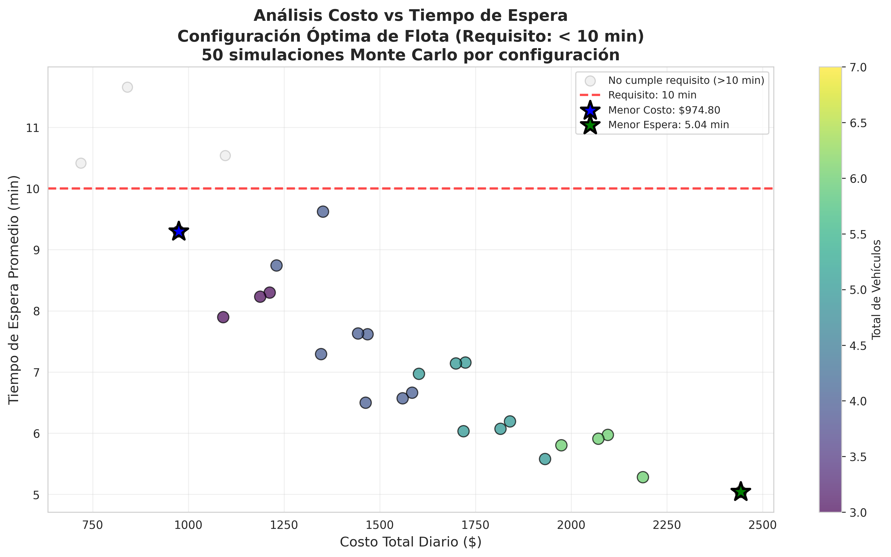

# Fleet Sizing with Monte Carlo Simulation

Which mix of buses and vans should run a corporate passenger shuttle from 6:00 to 22:00 so that the average wait stays under 10 minutes, at the lowest daily cost? This project answers that with a discrete-event Monte Carlo simulation built on the service's real trip data.

**Result:** 24 of 27 feasible fleets meet the 10-minute target. The cheapest, 1 Bus B + 1 Van A + 1 Van B, costs **$974.80 a day** with a 9.30-minute average wait, against $2,443.00 a day for the fastest fleet (5.04 minutes).



## The problem

| Vehicle | Seats | Hours | Cost per hour | Available |
|---|---|---|---|---|
| Bus A | 37 | 6:00 to 17:00 | $42.60 | 1 |
| Bus B | 31 | 8:00 to 14:00 | $42.60 | 2 |
| Van A | 19 | 6:00 to 20:00 | $24.80 | 1 |
| Van B | 13 | 7:00 to 22:00 | $24.80 | 3 |

Constraints: continuous service from 6:00 to 22:00, an average wait under 10 minutes, and no more vehicles than are available. 27 combinations satisfy the coverage constraint.

## Method

- **Passenger arrivals** follow a non-homogeneous Poisson process. The mean time between arrivals changes through the day: 3.0 min (6 to 8), 2.0 min (8 to 10), 3.0 min (10 to 13), 1.6 min at the afternoon peak (13 to 17) and 2.6 min (17 to 22).
- **Vehicle trips** are generated by resampling real gaps between departures, recorded in four time windows (6 to 9, 9 to 14, 14 to 18 and 18 to 22).
- **Queueing** is simulated event by event: all trips are merged in time order, passengers queue first come, first served, and each departing vehicle boards up to its capacity.
- **Monte Carlo:** every configuration is simulated 50 times with different seeds (1,350 simulated days in total), and the mean, standard deviation and range of each metric are reported.
- **Metrics:** average and maximum wait, average and maximum queue, passengers served, trips per day, vehicle occupancy and daily cost.

## Results

| Option | Fleet | Daily cost | Average wait | Max wait | Average queue |
|---|---|---|---|---|---|
| Cheapest | 1 Bus B, 1 Van A, 1 Van B | $974.80 | 9.30 min | 32.3 min | 5.7 |
| Balanced | 1 Van A, 3 Van B | $1,463.20 | 6.50 min | 32.0 min | 3.2 |
| Fastest | 1 Bus A, 2 Bus B, 1 Van A, 3 Van B | $2,443.00 | 5.04 min | 27.6 min | 2.4 |

- The notebook recommends the cheapest fleet: it meets the target and saves about $536,000 a year compared with the fastest one.
- Its 9.30-minute average leaves little margin under the 10-minute limit. If demand grows, the balanced fleet cuts the wait by 30% for 50% more cost.
- The afternoon peak (13:00 to 17:00), with the highest arrival rate, is where queues build up.
- Maximum waits stay around 30 minutes even for the fastest fleet, so adding vehicles mainly lowers the average wait rather than the worst case.

All results are exported to [`data/resultados_optimizacion_flota.csv`](data/resultados_optimizacion_flota.csv), and the figures are in [`plots/`](plots/).

## Limitations

- Arrival rates are fixed per time window; day-to-day variation in demand is not modeled.
- Vehicle trips are resampled from historical gaps, so the simulation assumes future schedules behave like the recorded ones.
- Costs are hourly vehicle costs only (no fixed or maintenance costs).

## Running it

```bash
git clone https://github.com/MarcosSaade/fleet-optimization.git
cd fleet-optimization
pip install -r requirements.txt
jupyter notebook optimizacion_flota.ipynb
```

The notebook and its output are in Spanish.

To adapt it: vehicle capacities, hours and costs are in `VEHICLES`, arrival rates are in `generate_passenger_arrivals()`, and the number of runs is `N_SIMULATIONS`.

## Project structure

```
optimizacion_flota.ipynb    simulation, analysis and plots
data/
  *_full.csv                recorded gaps between departures, one file per time window
  resultados_optimizacion_flota.csv   metrics for every configuration
plots/                      cost vs. wait, configuration comparison, timeline, occupancy, Monte Carlo spread
```

Main classes: `VehicleType` (capacity, hours, cost), `BusArrivalData` (loads and resamples departure gaps), `FleetSimulator` (the queueing simulation) and `DetailedFleetSimulator` (adds per-trip tracking).

More on the project: [marcossaade.github.io/fleet-optimization](https://marcossaade.github.io/fleet-optimization)
